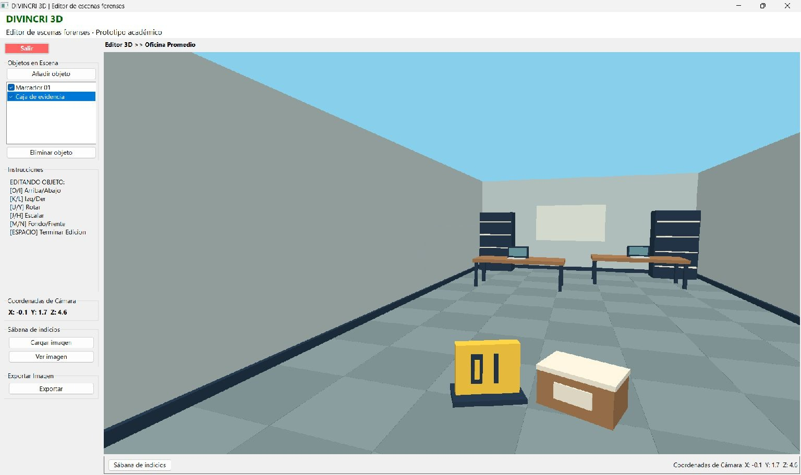
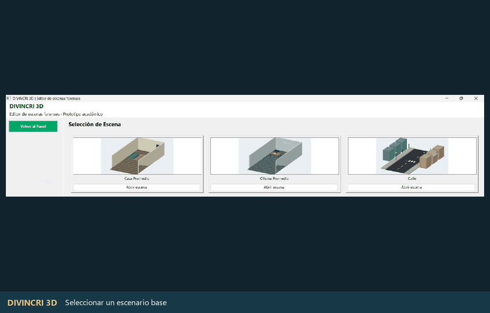
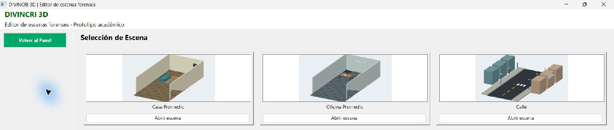
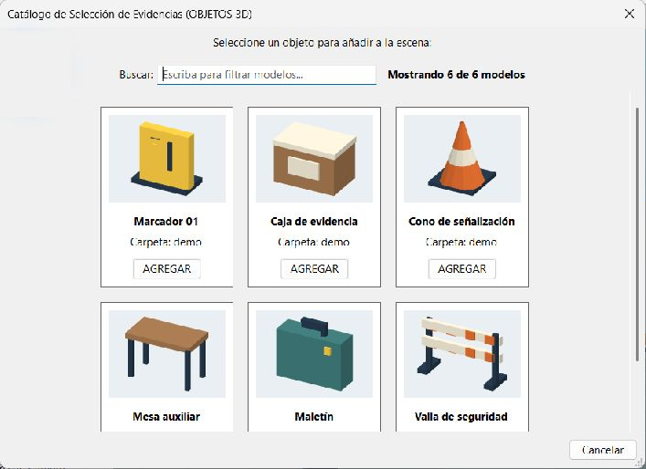
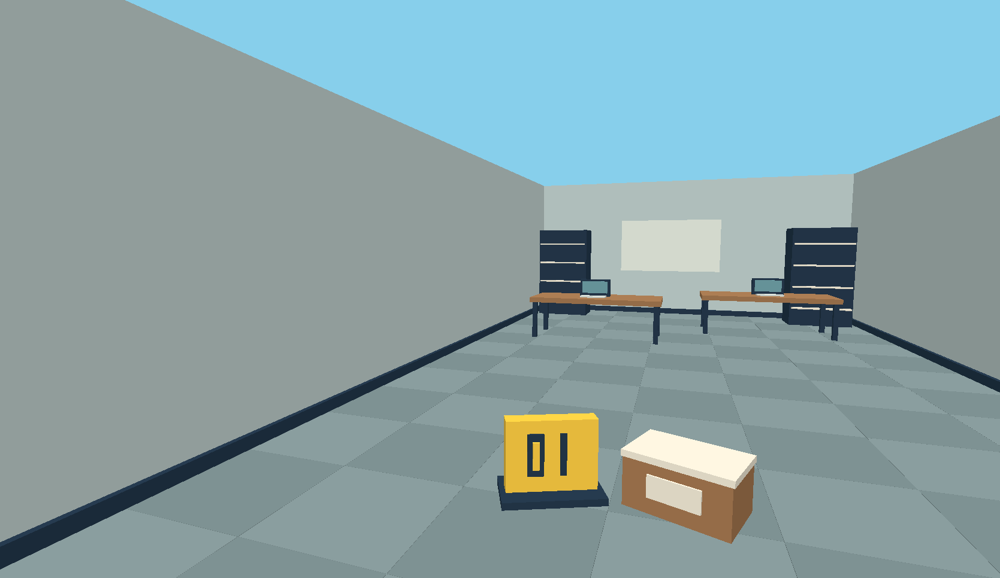

# DIVINCRI 3D · Editor de escenas forenses

Prototipo académico de escritorio para recrear escenas forenses en Windows. Permite partir de un escenario 3D, colocar y ajustar indicios simulados y exportar una captura del visor. Desarrollado en **C++**, con **wxWidgets** para la interfaz y **OpenGL** para el renderizado.



## Demostración

El GIF recorre la selección de escenario, la búsqueda de un modelo, su colocación y ajuste, la consulta de una sábana de indicios y la exportación a PNG.



| Selector de escenarios | Catálogo de modelos | PNG exportado |
| --- | --- | --- |
|  |  |  |

## Funcionalidades

- **Escenas base** de casa, oficina y calle con navegación en primera persona y coordenadas de cámara en tiempo real.
- **Catálogo con búsqueda** y seis modelos 3D incluidos en la demo.
- **Edición de objetos** con traslación, rotación y escala. La lista permite seleccionar, ocultar y eliminar objetos.
- **Sábana de indicios** que se puede cargar y consultar como imagen PNG o JPEG. Hay un [ejemplo ficticio](assets/demo/sabana-ejemplo.png) en el repositorio.
- **Exportación PNG** de la vista 3D desde el editor.

La edición es por sesión y funciona sin conexión ni base de datos. El guardado y la reapertura de proyectos editables y el modo entrenamiento quedaron en la etapa de diseño académico.

## Cómo probarlo

**Con el ZIP de Windows x64**. En Windows 10 u 11, extrae el contenido completo en una carpeta y abre `DIVINCRI-3D.exe`. Conserva `assets/` y las DLL junto al ejecutable. [Descargar v0.1.0](https://github.com/Yanxmarcos/divincri-3d/releases/download/v0.1.0/DIVINCRI-3D-v0.1.0-windows-x64.zip)

**Desde el código fuente**. Usa MinGW-w64 x64 con GCC y `windres` en el `PATH`, y wxWidgets **3.3.1** compilado con el mismo MinGW como DLL Unicode monolítica, con OpenGL habilitado. La compilación de wxWidgets debe tener la configuración `lib/gcc_dll/mswu` y las bibliotecas `libwxmsw33u.a` y `libwxmsw33u_gl.a`.

```powershell
.\tools\build.ps1 -WxRoot 'C:\wxWidgets-3.3.1'
.\build\windows\DIVINCRI-3D.exe
```

El script coloca el ejecutable, las dependencias de ejecución y los recursos en `build/windows/`. Se conserva el [proyecto de Code::Blocks](SISTEMA_DIVINCRI.cbp), que usa la variable global `wx` para resolver la instalación de wxWidgets.

La demo se compiló con GCC 14.2.0 y wxWidgets 3.3.1. La prueba manual en Windows verificó los tres escenarios, la búsqueda y edición de objetos, el regreso al panel, la carga de la sábana de indicios y una exportación PNG.

### Controles del editor

Haz clic dentro del visor para activar los controles. Selecciona un objeto de la lista antes de transformar su posición, rotación o escala.

| Acción | Control |
| --- | --- |
| Mover la cámara y cambiar la vista | `W` `A` `S` `D` y ratón |
| Subir o bajar un objeto | `O` / `I` |
| Mover un objeto a izquierda o derecha | `K` / `L` |
| Ajustar profundidad | `M` / `N` |
| Rotar sobre el eje vertical | `U` / `Y` |
| Aumentar o reducir escala | `J` / `H` |
| Terminar edición de objeto y soltar la cámara | `Espacio` y `Esc`, respectivamente |

## Autoría

Desarrollé íntegramente el software como parte de un proyecto académico grupal del curso **Tópicos en Tecnologías Inmersivas** de la **Universidad Nacional de Trujillo**. Los demás integrantes elaboraron el informe académico.

La versión de portafolio incluye escenas y modelos ligeros creados para la demo. Las capturas muestran la aplicación compilada con esos recursos y con datos ficticios. Consulta [Recursos y dependencias](THIRD_PARTY_ASSETS.md).
